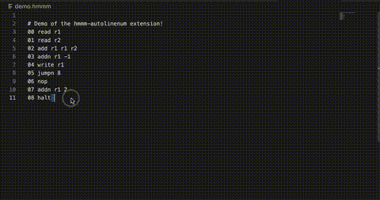

# hmmm-auto-linenum README

## Features

Auto line numbers your HMMM code! 

- New line number upon entering   
- Line numbers automatically readjust when commenting out and moving lines 
- `jumpn` values automatically readjust 

## Requirements

No requrements or dependencies. 

## Extension Settings

This extension contributes the following settings:

`hmmm-auto-linenum.enable`: Enable/disable this extension.

- Use the `"HMMM: Toggle Auto Line Numbering"` command to toggle auto line numbering without directly enabling/disabling the entire extension. 

## Release Notes

### 1.0.0

Initial release 

